# Лабораторная работа №6 "Система контроля версий"

## Содержание отчета
1. [Цель работы](#Цель-работы)
2. [Порядок выполнения лабораторной работы](#Порядок-выполнения-лабораторной-работы)
3. [Ход выполнения работы](#Выполнение-лабораторной-работы)
4. [Лог команд](#Лог-команд)
5. [История операций в форматированном виде](#История-операций-в-форматированном-виде)
6. [Вывод](#Вывод)

## Цель работы
Изучение базовых возможностей системы управления версиями, опыт работы с Git Api, опыт работы с локальным и удаленным репозиторием.

## Порядок выполнения лабораторной работы
1. Создать аккаунт на сайте GitHub.
2. Сделать копию в личное хранилище из https://github.com/Kurtyanik/LR6/ (Fork).
3. Установить Git (https://git-scm.com/).
4. После установки настроить клиент git, введя имя пользователя (Группа Фамилия И.О.) и email.
5. Клонировать свой личный удалённый репозиторий на компьютер.
6. Добавить файл через интерфейс GitHub. Подтянуть изменения в локальный репозиторий. Работу продолжать локально.
7. Получить историю операций для каждой из веток.
8. Просмотреть последние изменения.
9. Выполнить слияние в ветку master, разрешив конфликт (можно использовать специальные редакторы или графический интерфейс git).
10. Удалить побочную ветку после успешного слияния.
11. Сделать изменения и зафиксировать их, оставляя комментарии, несколько раз.
12. Сделать откат коммита.
13. Создать ветку для отчёта.
14. Начать оформлять отчёт в файле README.md (разрешены сторонние редакторы с подсветкой синтаксиса), используя markdown синтаксис (https://guides.github.com/features/mastering-markdown/):
* В отчёте должен быть снимки экрана консоли и сторонних программ. Файлы снимков экрана разместить в отдельной папке.
* Лог команд (без результатов их выполнения). При написании отчёта периодически делать коммиты, не забывать комментировать.
15. Получить историю операций в форматированном виде (сокращённый хэш + дата + имя автора + комментарий). Добавить её в отчёт и сделать финальную фиксацию изменений.
16. Отправить локальные изменения в сетевое хранилище GitHub (если делаете работу постепенно, то синхронизацию проводить в конце рабочего сеанса) 

## Ход выполнения работы

### 1. Создание аккаунта на сайте GitHub
Для создания аккаунта на GitHub необходимо перейти по ссылке https://github.com/signup и заполнить форму регистрации (рис. 1).
<div align='center'>
    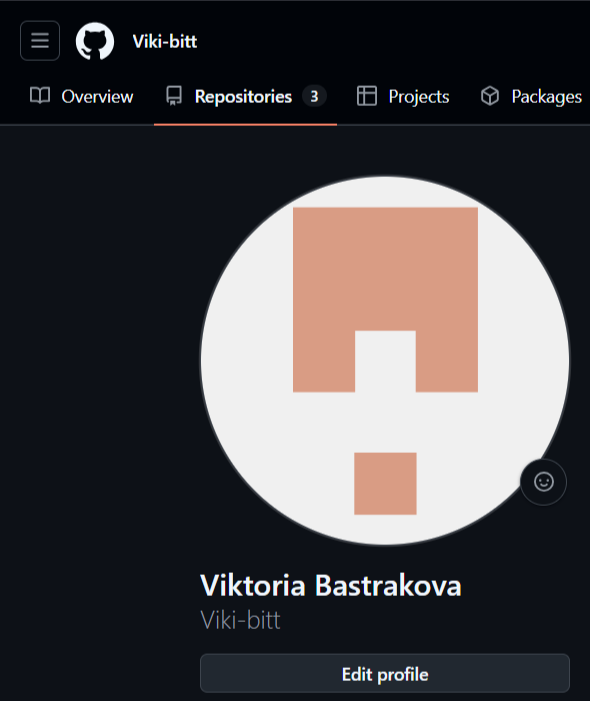
    <br>
    Рисунок 1 - Создание аккаунта на GitHub
</div>

### 2. Создание копии в личное хранилище из https://github.com/Kurtyanik/LR6/ (Fork)
Для создании копии в личное хранилище нужно скопировать репозиторий преподавателя из https://github.com/Kurtyanik/LR6/ (рис. 2). После нажатия кнопки Create fork репозиторий будет скопирован (рис. 3).
<div align='center'>
    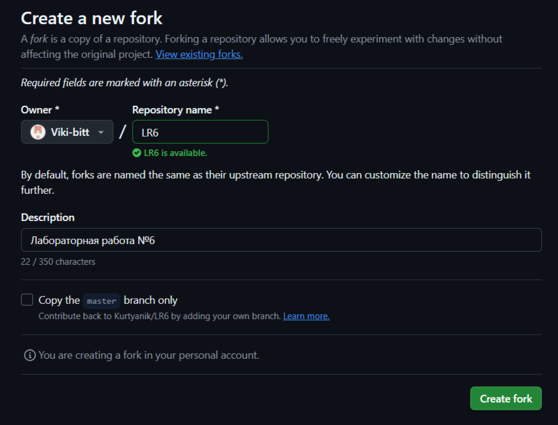
    <br>
    Рисунок 2 - Настройки копирования репозитория
</div>
<div align='center'>
    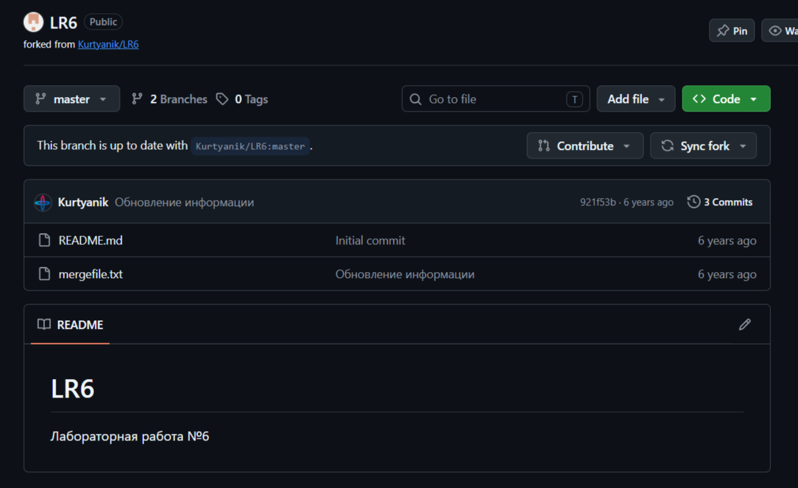
    <br>
    Рисунок 3 - Скопированный репозиторий
</div>

### 3. Установка Git (https://git-scm.com/)
Для установки Git нужно перейти на сайт https://git-scm.com/ и выбрать версию для установки (рис. 4).
<div align='center'>
    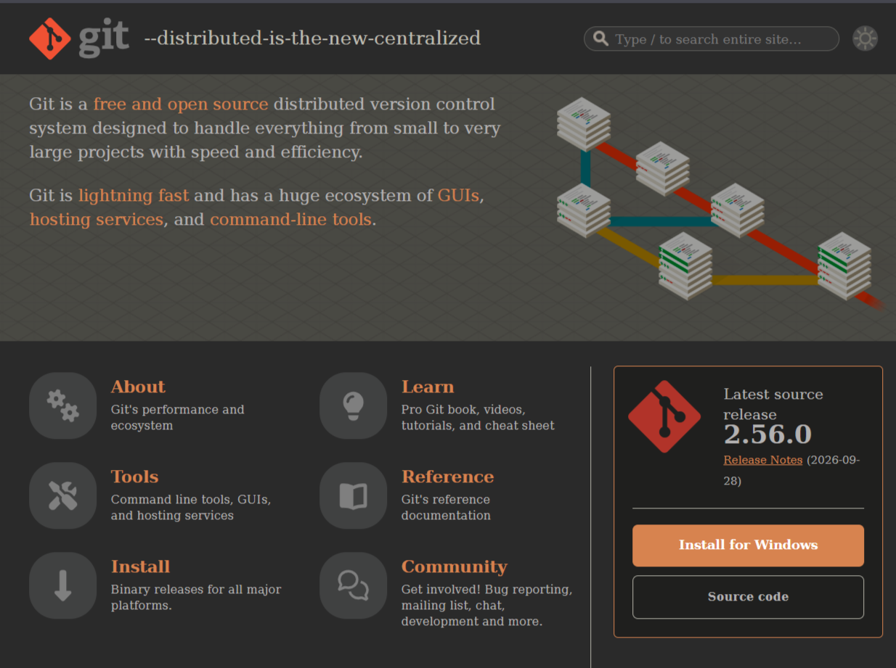
    <br>
    Рисунок 4 - Сайт Git
</div>

### 4. Натсройка клиента git
Для того, чтобы настроить клиент git нужно использовать следующие комнады:
```bash
git config --global user.name "имя пользователя"
git config --global user.email "email пользователя"
```
В итоге были указаны группа, Фамилия И.О. и email (рис. 5).
<div align='center'>
    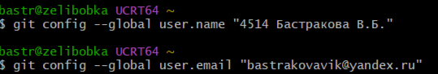
    <br>
    Рисунок 5 - Настройка клиента Git
</div>

### 5. Клонирование своего личного удалённого репозитория на компьютер
Чтобы скопировать удаленный репозиторий на компьютер сначала нужно перейти в папку, где должен храниться репозиторий. Это можно сделать с помощью команды:
```bash
cd (путь)
```
Далее для клонирования репозитория (рис. 6) используется команда:
```bash
git clone (ссылка на удаленный репозиторий)
```
<div align='center'>
    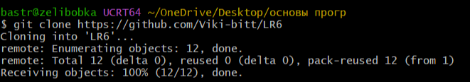
    <br>
    Рисунок 6 - Копирование удаленного репозитория 
</div>

### 6. Добавление файла через интерфейс GitHub. Подтягивание изменений в локальный репозиторий
Для добавления изменений через интерфейс GitHub нужно добавить новый файл. Для этого нужно нажать на Add file и выбрать Create new file (рис. 7). 
<div align='center'>
    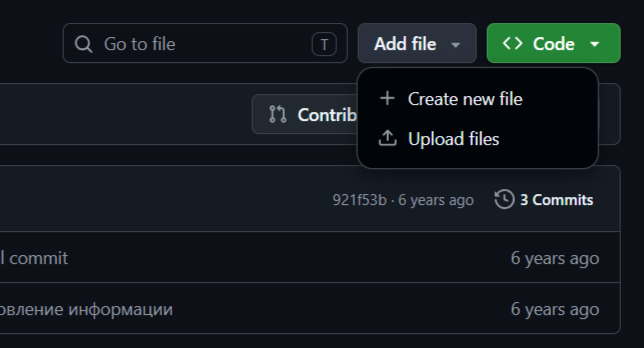
    <br>
    Рисунок 7 - Создание нового файла 
</div>
<br>
Затем необходимо написать содержимое файла и дать файлу название, после подтверждения изменений файл будет сохранен в репозитории (рис. 8-9).
<div align='center'>
    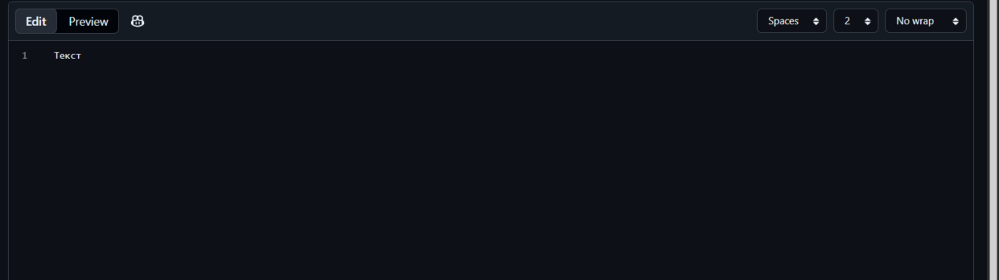
    <br>
    Рисунок 8 - Содержимое файла 
</div>
<div align='center'>
    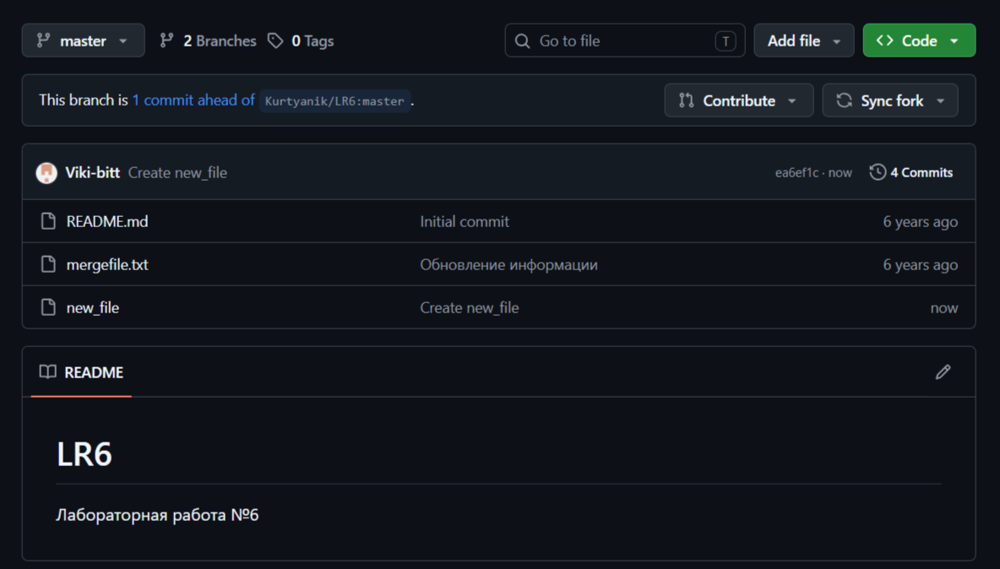
    <br>
    Рисунок 9 - Файл в репозитории 
</div>
<br>
Для синхронизации локальной копии репозитория с измененниями используется команда:

```bash
git pull 
```
Список файлов в локальном репозитории можно увидеть с помощью команды:
```bash
ls -1 
```
После синхронизации локальной копии в списке файлов появился добавленный new_file (рис. 10).
<div align='center'>
    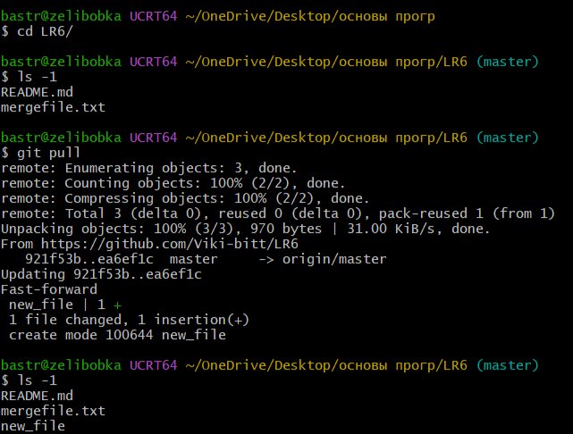
    <br>
    Рисунок 10 - Локальный репозиторий до и после добавления new_file 
</div>

### 7. Получение истории операций для каждой из веток
Для того, чтобы увидеть историю коммитов в ветке, используется команда:
```bash
git log (название ветки)
```
История коммитов в ветке master представлена на рисунке 11.
<div align='center'>
    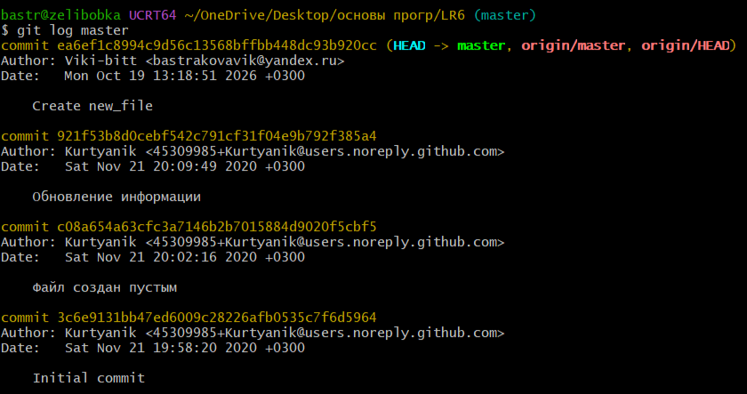
    <br>
    Рисунок 11 - История изменений в ветке master 
</div>
<br>
Для того, чтобы поменять ветку можно использовать команду:

```bash
git checkout (название ветки)
```
После смены ветки были просмотрены изменения в ветке branch1 (рис. 12).
<div align='center'>
    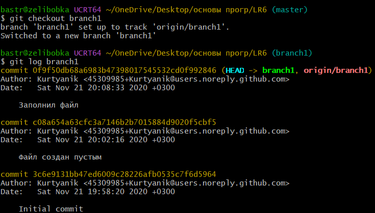
    <br>
    Рисунок 12 - История изменений в ветке branch1
</div>

### 8. Просмотр последних изменений
Для просмотра последних изменений в ветке использована команда:
```bash
git show (название ветки)
```
Таким образом была использована команда 'git show branch1' для просмотра изменений в ветке branch1 (рис. 13).
<div align='center'>
    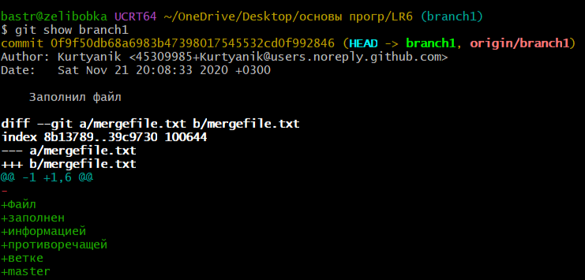
    <br>
    Рисунок 13 - Просмотр изменений в ветке branch1
</div>
<br>
Чтобы посмотреть изменения в ветке master, нужно переключиться на нее. После использовать команду 'git show master' (рис. 14).
<div align='center'>
    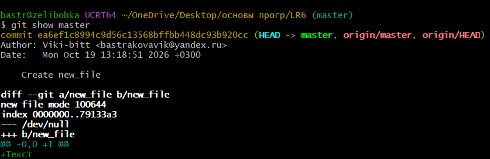
    <br>
    Рисунок 14 - Просмотр изменений в ветке master
</div>

### 9. Выполнение слияния в ветку master, разрешив конфликт (можно использовать специальные редакторы или графический интерфейс git)
Для объединения изменений из одной ветки в основную ветку можно использовать команду:
 ```bash
git merge (название неосновной ветки)
```
После использования команды на ветке branch1 возник конфликт (рис. 15).
<div align='center'>
    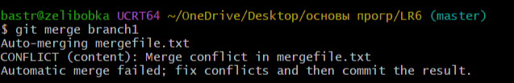
    <br>
    Рисунок 15 - Возникновение конфликта
</div>
<br>
Чтобы вывести причину возникновения конфликта на консоль (рис. 16), нужно использовать команду:

```bash
git diff
```
<div align='center'>
    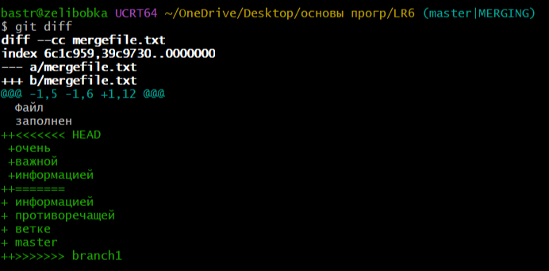
    <br>
    Рисунок 16 - Вывод конфликта на консоль
</div>
<br>
Для разрешения конфликта был использован текстовый редактор nano (рис. 17), который можно открыть командой:

```bash
nano (название файла).txt
```
<div align='center'>
    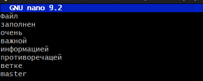
    <br>
    Рисунок 17 - Редактирование файла в nano
</div>
<br>
Далее необходимо добавить файл в индекс. Это можно сделать с помощью команды:

```bash
git add (название файла).txt
```
К файлу была применена команда 'git add mergefile.txt'. Затем для проверки, что конфликт исправлен используется команда:

```bash
git status
```
Для фиксирования изменения:

```bash
git commit -m "Текст комментария"
```
Разрешение конфликта представлено на рисунке 18.
<div align='center'>
    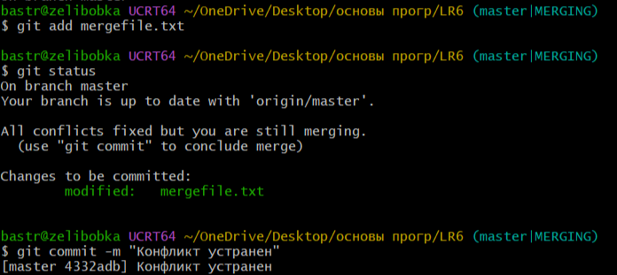
    <br>
    Рисунок 18 - Завершение слияния
</div>

### 10. Удаление побочной ветки после успешного слияния
Для удаления побочной ветки после слияния (рис. 19) можно использовать команду:

```bash
git push origin --delete (название ветки)
```
<div align='center'>
    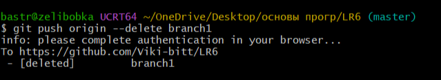
    <br>
    Рисунок 19 - Удаление ветки branch1
</div>

### 11. Создание изменений и их фиксация с комментариями
Для создания исзменений можно использовать команду:

```
echo "Текст" > (название файла).txt
```

С помощью использования 'echo' был создан файл 'first.txt'. Чтобы добавить файл в индекс была использована команда:

```bash
git add (название файла)
```
После чего применена команда 'git commit -m "Первый сделан"'. Затем изменеия отпралены на GitHub с помощью команды:
```bash
git push
```
Добавление первого и второго изменения с комментариями представлены на рисунках 20-21.
<div align='center'>
    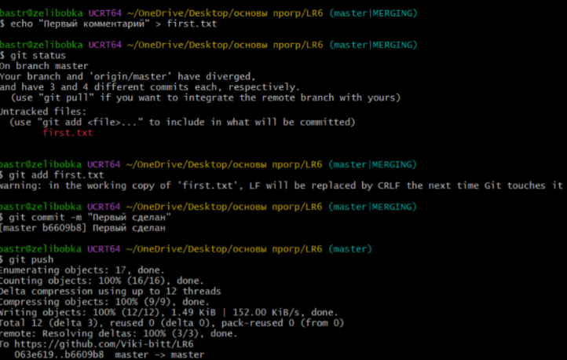
    <br>
    Рисунок 20 - Добавление первого изменения
</div>
<div align='center'>
    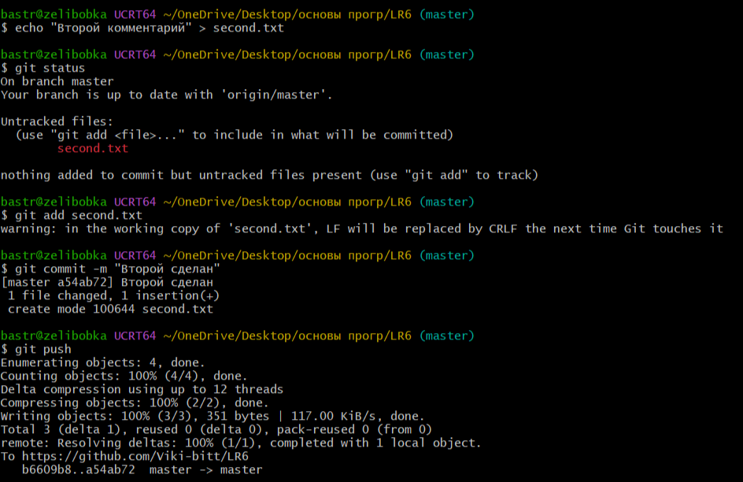
    <br>
    Рисунок 21 - Добавление второго изменения
</div>

### 12. Создание отката коммита
Для отката коммита используется команда:
```bash
git reset 
```
Перед откатом была выведена история коммитов с помощью команды 'git log'(рис. 22).
<div align='center'>
    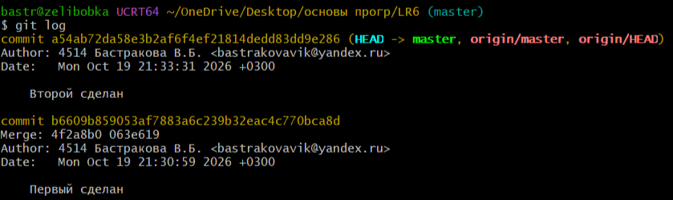
    <br>
    Рисунок 22 - История коммитов
</div>
<br>
Для отмены последнего коммита была выполнена команда 'git reset HEAD~1' (рис. 23).
<div align='center'>
    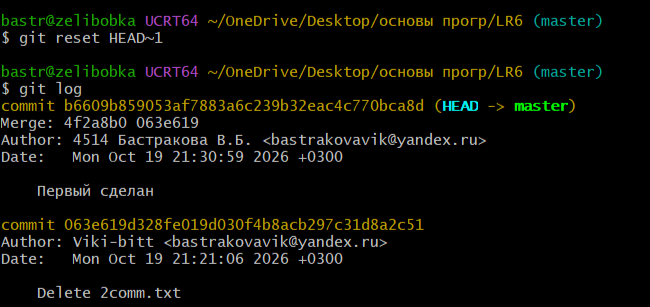
    <br>
    Рисунок 23 - Откат последнего коммита
</div>

### 13. Создание ветки для отчёта
Для создания ветки для отчета (рис. 24) была использована команда, создающая новую ветку:
```bash
git branch (название ветки) 
```
<div align='center'>
    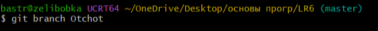
    <br>
    Рисунок 24 - Создание ветки Otchot
</div>

### 14. Начало оформления отчёта в файле README.md с использованием markdown синтаксиса (https://guides.github.com/features/mastering-markdown/)
Для удобного форматирования файла README.md для оформления отчета был использован редактор кода VS Code (рис. 25).
<div align='center'>
    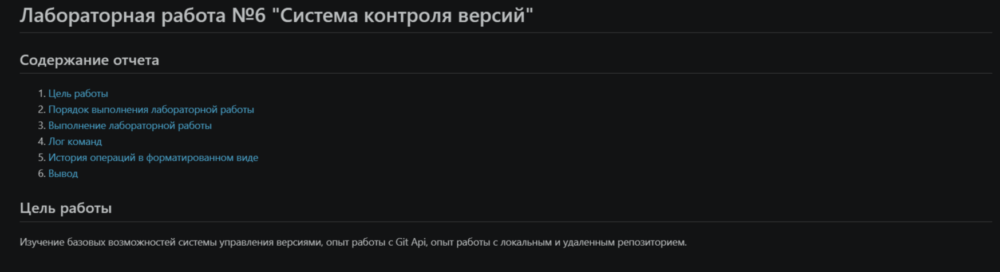
    <br>
    Рисунок 25 - Начало офрмления отчета
</div>

### 15. Получение истории операций в форматированном виде
Для получения истории операций в форматированном виде (рис. 26) можно исопльзовать команду:
```bash
git log --date=format:'%D' --pretty=format:"%h -> %cd, %cn ( %s )" 
```
<div align='center'>
    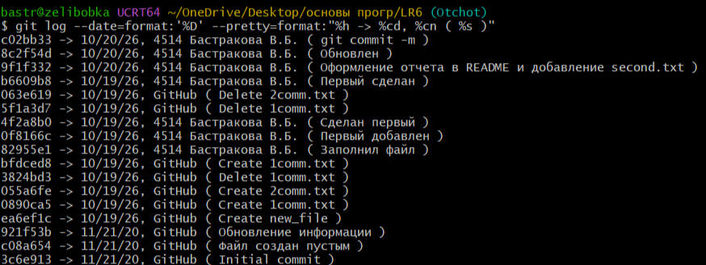
    <br>
    Рисунок 26 - Истории операций в форматированном виде
</div>

### 16. Отправление локальных изменений в сетевое хранилище GitHub
Для отправки локальных изменений в сетевое хранилище используется команда:
```bash
git push 
```

## Лог команд
git config --global user.name "4514 Бастракова В.Б."

git config --global user.email "bastrakovavik@yandex.ru"

cd "C:\Users\bastr\OneDrive\Desktop\основы прогр"

git clone https://github.com/Viki-bitt/LR6.git

cd LR6/

ls -1

git pull

ls -1

git log master

git log branch1

git checkout branch 1

git checkout branch1

git show branch1

git checkout master

git show master

git merge branch1

git diff

git status

git mergefile.txt

nano mergefile.txt

git add mergefile.txt

git status

git commit -m "Конфликт устранен"

git branch -d branch1

git push origin --delete branch1

git status

echo "Первый комментарий" > first.txt

git status

git add first.txt

git commit -m "Первый сделан"

git push

echo "Второй комментарий" > second.txt

git status

git add second.txt

git commit -m "Второй сделан"

git push

git log

git reset HEAD~1

git log

git branch Otchot

git checkout Otchot

git push origin Otchot

code README.md

git log --date=format:'%D' --pretty=format:"%h -> %cd, %cn ( %s )"

git push

## История операций в форматированном виде
c02bb33 -> 10/20/26, 4514 Бастракова В.Б. ( git commit -m )

8c2f54d -> 10/20/26, 4514 Бастракова В.Б. ( Обновлен )

9f1f332 -> 10/20/26, 4514 Бастракова В.Б. ( Оформление отчета в README и добавление second.txt )

b6609b8 -> 10/19/26, 4514 Бастракова В.Б. ( Первый сделан )

063e619 -> 10/19/26, GitHub ( Delete 2comm.txt )

5f1a3d7 -> 10/19/26, GitHub ( Delete 1comm.txt )

4f2a8b0 -> 10/19/26, 4514 Бастракова В.Б. ( Сделан первый )

0f8166c -> 10/19/26, 4514 Бастракова В.Б. ( Первый добавлен )

82955e1 -> 10/19/26, 4514 Бастракова В.Б. ( Заполнил файл )

bfdced8 -> 10/19/26, GitHub ( Create 1comm.txt )

3824bd3 -> 10/19/26, GitHub ( Delete 1comm.txt )

055a6fe -> 10/19/26, GitHub ( Create 2comm.txt )

0890ca5 -> 10/19/26, GitHub ( Create 1comm.txt )

ea6ef1c -> 10/19/26, GitHub ( Create new_file )

921f53b -> 11/21/20, GitHub ( Обновление информации )

c08a654 -> 11/21/20, GitHub ( Файл создан пустым )

3c6e913 -> 11/21/20, GitHub ( Initial commit )

## Вывод
В ходе выполнения лабораторной работы были изучены базовые возможности системы управления версиями, получен опыт работы с Git Api и опыт работы с локальным и удаленным репозиторием.

Был получен практический опыт работы с основными функциями системы контроля версий Git, таких как: клонирование репозитория, слияние веток, разрешение конфликта, удаление веток, просмотр истории имзменений и операций в форматированном виде.